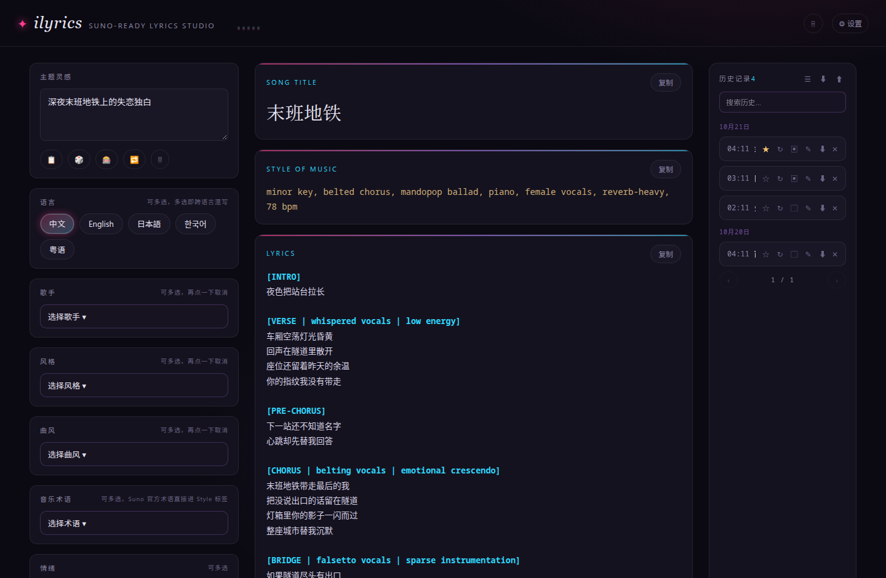

# ilyrics

本地 AI 歌词工作室：零依赖 Node 服务 + 浏览器前端，调用本机 llama.cpp（`127.0.0.1:8080`）生成 Suno 可直接粘贴的歌词三件套——歌名 / 全英文 style tags / 带段落标签的完整歌词。



## 功能

- **主题灵感**：100 个当下热门方向，🎲 随机灵感一键抽取；🎰 盲盒配方一键随机整套组合（歌手/风格/曲风/情绪/人声）
- **🔁 Remix**：扔一首歌的歌词进去，生成一首保留原作情绪骨架的全新改编
- **歌手（109）/ 风格（101）/ 曲风（50）**：下拉多选、一行 5 个、悬停提示、可搜索，控件间零联动
- **音乐术语（47）**：借鉴 Suno 官方术语表（速度 Adagio/Allegro、力度 Crescendo、织体 Sparse/Dense、人声技巧 Falsetto/Belt/Melisma、制作 Reverb/Distortion、调性 Minor Key、拍子 3/4 Waltz 等），多选后原样写进 style tags，prompt 强制生效；数据维护可增删改
- **语言多选**（中/英/日/韩/粤）、情绪多选、人声单选（男声/女声/男团/女团/男女对唱/合唱）
- **结构模板**：点选段落骨架（流行标准/Rap 流水/摇滚/R&B 慢板/EDM 舞曲/民谣叙事/爵士），默认跟随曲风，盲盒也会随机装填
- **批量 ×3 首备选**：同一设定并发 3 个请求（本地 llama.cpp 多 worker），出 3 首草稿挑一首 ✓ 进正式输出，其余丢弃
- **🏷 重想歌名 ×3**：歌词不动，并发出 3 个歌名候选，点一个定下并同步进历史
- **🎼 重想风格**：歌名歌词不动，根据歌词与当前设定重想 Style of Music 标签（全英文、含 BPM、自动规避艺人名、音乐术语原样保留）并同步进历史
- **局部重写**：生成后按段落一键重写（只改 [Chorus] 等指定段，其余一字不动）；每次重写生成新版本（V1 原版/V2…），chips 随时切换，⇄ 看改动高亮本次重写删了/加了哪些行
- **歌词直接编辑**：歌词区逐行可手改，失焦自动按 v6 铁律规范化并记为新版本（✏️ 手动编辑），歌名/标签手改也直接存进历史
- **♫ 押韵 / 音节 + 可唱性评分**：按段标押韵组徽章（中文按十三辙分组：江阳/怀来/言前/由求…，英文按尾音），每行字数/词数与段内区间，每段打可唱性分（押韵 60% + 音节 40%），低于 70 分的段标红并给出重写建议
- **🔧 押韵自动修复**：押韵覆盖率低于 60% 的段一键逐段重写，指令强制行尾落在同一韵辙（禁止原样返回），语义、语言、人声标注保持不动，每段记一个新版本
- **💾/🎞 预设场景**：把当前整套设定（主题/语言/歌手/风格/曲风/术语/人声/结构/情绪/remix）存成命名配方，场景库一键装填复用，最多存 20 套，随时删除
- **Suno v6 格式铁律**：标签行全大写且不含数字与标点（`[VERSE 2]` 自动规范为 `[VERSE]`），段落间恰好空一行，最后一行 `[END]` 强制收尾，每行 6-12 音节；可在标签内用竖线叠加指令（`[CHORUS | anthemic | stacked harmonies]`），重写 chips 与本地规范化（`normalizeLyrics`/`canonTagLine`）全程保这套格式
- **快捷键**：Ctrl+Enter 生成、Ctrl+D 随机灵感、Esc 关弹窗/停止生成
- **可编辑输出**：歌名与 style tags 直接改了保存进历史；行数字数与按 BPM 估算的时长统计
- **流式输出**：实时解析 + 真实 tok/s（读 llama.cpp timings），截断有兜底恢复
- **参数面板**：模型下拉（从上游 `/v1/models` 拉取）、temperature、max_tokens 滑杆
- **历史侧栏**：收藏（★置顶）、重命名、导出 txt，点条目一键回填全部选项（含 remix 原作与版本状态）；↻ 按原设定一键再写一首；▢ 归入专辑（条目标显示专辑名），☰ 导出全部专辑 tracklist（歌名 + style tags 汇总）；⬇/⬆ 一键导出/导入全量历史 JSON 备份（按 ts 去重合并）
- **PWA**：可安装，移动端自适应；style_tags 合并去重并自动规避真实艺人名
- **歌词厚度**：贯穿全曲的隐喻域逐级升级、每行双小句（画面+隐喻）、副歌 signature hook 贯穿重复、括号 ad-lib 舞台指令行（(Drop the bass!) 这类，Suno 按 ad-lib 唱）、行内跨语言 code-switch；新增「史诗升级」结构模板（含 POST-CHORUS 与 DANCE BREAK）
- **单测**：`npm test` 固化格式铁律（标签规范/空行/重写拼接/十三辙押韵分组/ad-lib 打分/可唱性打分/版本 diff）回归测试
- **Tailwind CSS**：样式为 Tailwind v4（`tailwind.src.css`：@theme 霓虹令牌 + @layer components），构建产物 `tailwind.css` 随仓库提交、离线可用；改样式后 `npm install && npm run build` 重新生成

## 使用

```bash
./server.sh install    # 环境检查（node / 上游 llama.cpp）
./server.sh start      # 启动（默认端口 4100）
./server.sh status     # 状态
./server.sh restart    # 重启
./server.sh logs       # 日志
./server.sh stop       # 停止
```

打开 http://localhost:4100 即可。需要本机 llama.cpp 服务端在 `127.0.0.1:8080` 运行（server.js 内置 SSE 代理，绕过上游无 CORS 的限制）。

## 示例输出

```
Title: 末班地铁与未熄的灯

Style: Urban Melancholy, Lo-fi Hip Hop, Slow Tempo, Atmospheric

Lyrics:
[Verse]
屏幕的光刺眼
咖啡杯已凉透
键盘声敲得疲惫
灵魂在空转

[Chorus]
末班地铁呼啸
带走最后一丝清醒
工位灯还亮着
像守夜的幽灵
```

## License

MIT
